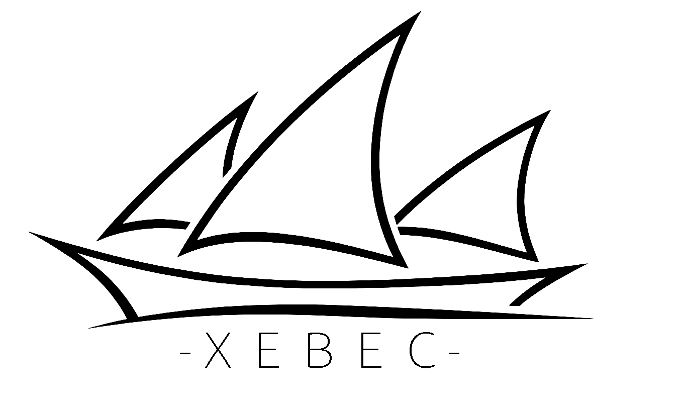

# Xebec

Built from scratch for the M-VAVE FM-1, fast and lean, no borrowed planks.

Xebec is a new firmware for the FM-1, written from the ground up on the chip's own SDK. No other FM-1 firmware sits underneath it: the board layer, the sound engine, the interface and the update path are all its own.

The name comes from the xebec, a narrow, fast Mediterranean sailing ship with lateen sails, built to outrun anything that chased it.

## Status

Early days. Xebec does not run on the FM-1 yet, and there is nothing to install or try in the browser. This page will grow as the firmware does.

## The road ahead

From a bare boot to the update path, the panel, audio, USB and MIDI, dual core and finally the sound engine: see the [roadmap](docs/ROADMAP.md).

## License

Xebec is free software under the GNU General Public License, version 3 only (GPL-3.0-only); see [LICENSE](LICENSE).

Xebec carries one file that is not its own: M-VAVE's update loader for the FM-1, unchanged, under the Apache License 2.0. Xebec stores and starts it but does not link it; see [vendor/m-vave](vendor/m-vave/README.md).

---

M-VAVE and FM-1 are trademarks of their respective owners; Xebec is not affiliated with or endorsed by them.
